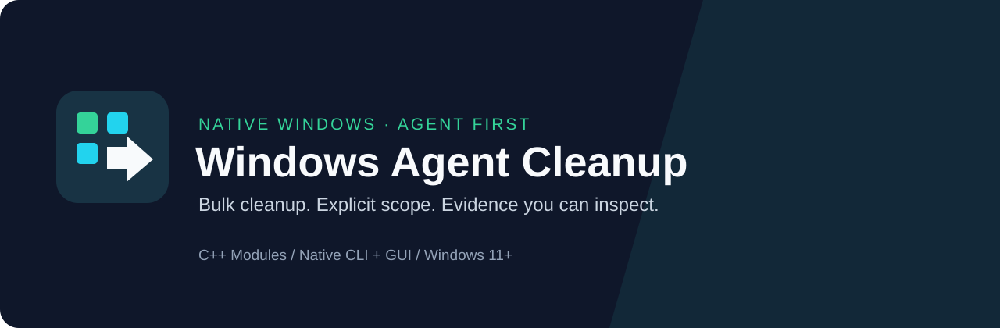

<p align="center"></p>

<h1 align="center">Windows Agent Cleanup</h1>

<p align="center">Native Windows cleanup for agents. One batch, one compact result.</p>

<p align="center"></p>

[繁體中文](README_zh_tw.md) · [Agent entry](README_AI.md) · [Contributing](CONTRIBUTING.md) · [Security](SECURITY.md)

Windows Agent Cleanup removes large project cleanup batches through a native C++ core shared by a machine-oriented CLI and a compact desktop GUI. Quick deletion removes selected names without reading or overwriting file contents. The separate overwrite workflow provides explicit, evidence-based sanitization results.

**Status: 2.0.0-rc.1 release candidate.** Native Windows build and hardware evidence determine release readiness. This project does not claim a hardware-independent maximum speed or physical NAND sanitization.

## Start with your agent

Place the tool on the same Windows machine as the files, then tell Codex, Claude Code, or another agent with local file and process access:

```text
Read C:/tools/windows_agent_cleanup/README_AI.md
```

The agent asks which cleanup plan to use and which project is in scope. After you choose, it identifies disposable material, submits a bulk manifest, and interprets a compact result. Reading the manual alone does not authorize deletion.

The direct README route needs no MCP server, Skill installation, Python, Node.js, or model SDK. Optional [Agent Skills](skills/project-cleanup/SKILL.md) provide discovery shortcuts to the same instructions.

## What the native core does

- Shares preparation, identity checks, scheduling, deferred failure recovery, and reporting between CLI and GUI.
- Freezes the selected batch before mutation; newly added or replacement targets are excluded.
- Preserves system protection and reparse boundaries. Distinct selected hardlink names remain distinct targets.
- Performs quick logical deletion without a content overwrite, readback pass, recycle bin, or per-file TRIM request.
- Keeps failure details in external reports while returning compact machine-readable summaries.

Capacity observations are measurements, not a guarantee that the job immediately released a specific number of bytes. Other open handles, remaining hardlinks, shared allocation, and snapshots can retain data or space.

## Build and inspect

Production targets Windows 11 or later on x64, MSVC, native C++ named modules and vendor `import std`. Build Release with the static MSVC runtime through `build_release.bat`. Build inputs, commands and validation boundaries are documented in [README_AI.md](README_AI.md#extend-or-build-this-project).

| Document | Purpose |
|---|---|
| [README_AI.md](README_AI.md) | Self-contained tool use and development entry |
| [Design](docs/design.md) | Core boundaries and operational invariants |
| [Approved requirements](spec/requirements.json) | Base requirements and explicit amendments |
| [Windows test plan](docs/windows_test_plan.md) | Platform and storage evidence |

Source, dependency locks, validation evidence and release artifacts must correspond to the same revision. Generated binaries and per-run logs do not belong in the source tree.
