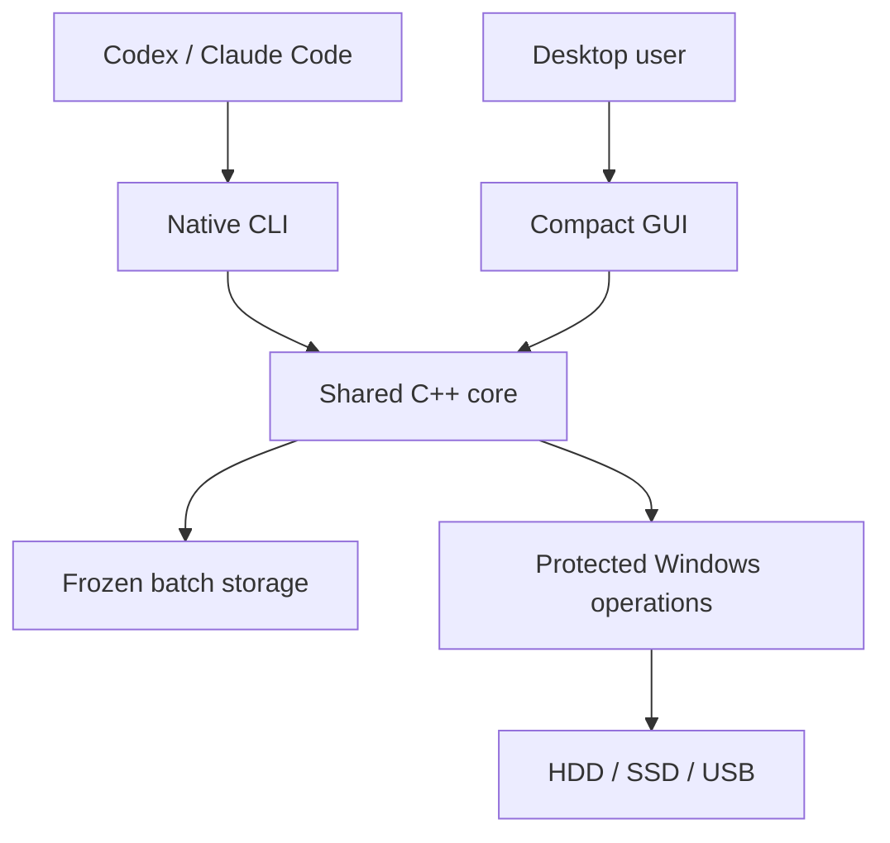

<p align="center"></p>

<h1 align="center">Windows Agent Cleanup</h1>

<p align="center">Native Windows cleanup for agents. One batch, one compact result.</p>

[](https://github.com/bestkakkoii/windows_agent_cleanup/actions/workflows/ci.yml)
[](https://github.com/bestkakkoii/windows_agent_cleanup/stargazers)
[](LICENSE)

<p align="center"></p>

[繁體中文](README_zh_tw.md) · [Agent entry](README_AI.md) · [Releases](https://github.com/bestkakkoii/windows_agent_cleanup/releases) · [Contributing](CONTRIBUTING.md) · [Security](SECURITY.md)

Windows Agent Cleanup removes large project cleanup batches through a native C++ core shared by a machine-oriented CLI and a compact desktop GUI. Quick deletion removes selected names without reading or overwriting file contents. The separate overwrite workflow provides explicit, evidence-based sanitization results.

**[Download the Latest Release for Windows x64](https://github.com/bestkakkoii/windows_agent_cleanup/releases/latest).** Its runtime ZIP contains GUI/CLI executables, runtime instructions, the complete Skill, schemas and licenses; application source and build/test files remain in Git. Obtain the distribution version, actual application version, hashes and validation scope from that Release and its manifest. Distribution and application versions can differ. Current evidence and remaining acceptance gaps are maintained in the [publication policy](docs/publication.md), rather than copied into this README. This project does not claim a hardware-independent maximum speed or physical NAND sanitization.

## Start with your agent

For ordinary Agent setup, use the official **[Latest Release](https://github.com/bestkakkoii/windows_agent_cleanup/releases/latest)** runtime assets:

1. Select the Windows x64 runtime ZIP and its matching `.sha256` asset from the same release record. GitHub's generated **Source code (zip/tar.gz)** downloads are engineering sources, not an installation package.
2. Verify the ZIP's SHA-256 against that release's checksum **before extraction** (`Get-FileHash -LiteralPath <downloaded_zip> -Algorithm SHA256`). Stop on a mismatch or missing checksum; do not run or extract an unverified archive.
3. Choose a suitable portable directory using available space, permissions and user/project scope. No drive or parent is prescribed. Reuse a valid installation; inspect provenance and dirty state before replacement, or use a separate portable directory rather than modifying a developer checkout.
4. Extract the **complete** runtime bundle, then give the local Agent the actual absolute entry path:

```text
Read <absolute path to the extracted tool>/README_AI.md
```

The Agent reuses supplied scope, plan and authority; it asks only for missing choices. Ordinary adoption never clones/downloads `main`/`master` or compiles source, and never grants deletion permission. The direct route needs no MCP, compiler, SDK, Python, Node.js, global PATH change or Skill registration. The [shared Skill](skills/project-cleanup/SKILL.md) owns the operational kernel and loads extended references only when needed. Source development is a separate explicit [engineering route](CONTRIBUTING.md#build-from-source).

## Use the GUI

Open `bin/secure_erase_gui.exe`, choose **Quick delete** or **Overwrite and verify**,
and add or drag files/folders. **Start** prepares the batch; review **Confirm
batch** and approve the irreversible action. “Frozen targets” describes that
fixed selection, not an error. Completed inputs leave the list; incomplete
inputs remain for review. For a failure, copy the diagnostic JSON with its native
error code. Overwrite downgrade and forced-process actions require separate
approval.

## What the native core does

- Shares preparation, identity checks, scheduling, deferred failure recovery, and reporting between CLI and GUI.
- Freezes the selected batch before mutation; newly added or replacement targets are excluded.
- Preserves system protection and reparse boundaries. Distinct selected hardlink names remain distinct targets.
- Performs quick logical deletion without a content overwrite, readback pass, recycle bin, or per-file TRIM request.
- Admits large batches using live resource budgets and indexed private scratch, then adjusts concurrency from measured completion rates and latency. No fixed target-count ceiling is imposed; insufficient resources can refuse a complete batch.
- Keeps failure details in external reports while returning compact machine-readable summaries.

The source supports an explicit v2 CLI contract for typed host readiness, shared operation statistics and read-only request status. Default calls retain v1. Select a contract using the exact runtime bundle's advertised capabilities; newer source documentation does not add features to an older executable.

Capacity observations are measurements, not a guarantee that the job immediately released a specific number of bytes. Other open handles, remaining hardlinks, shared allocation, and snapshots can retain data or space.



## Build and inspect

Production targets Windows 11 or later on x64, MSVC, native C++ named modules and vendor `import std`. Build Release with the static MSVC runtime through `build_release.bat`. Build inputs, commands and validation boundaries are documented in [CONTRIBUTING.md](CONTRIBUTING.md).

| Document | Purpose |
|---|---|
| [README_AI.md](README_AI.md) | Universal bootstrap and task routing |
| [Project cleanup Skill](skills/project-cleanup/SKILL.md) | Cleanup workflow, plans and on-demand references |
| [Design](docs/design.md) | Core boundaries and operational invariants |
| [Quick deletion technical report](docs/quick_delete_technical_report.md) | Actual Windows APIs, algorithms, resource formulas and reproduction protocol |
| [Approved requirements](spec/requirements.json) | Base requirements and explicit amendments |
| [Windows test plan](docs/windows_test_plan.md) | Platform and storage evidence |

Release records bind each artifact to its source reference, binary provenance and actual validation scope. Hashes and embedded identity alone are not independently attested source-to-binary correspondence; a documentation update on `main` does not replace the published asset. [Publication policy](docs/publication.md) separates development artifacts, approved prereleases and full Releases. Generated binaries and per-run logs do not belong in the source tree.

## Help and contributions

For a reproducible problem, [open an issue](https://github.com/bestkakkoii/windows_agent_cleanup/issues)
with the distribution/application versions, artifact hash or tested source
commit, Windows build and masked diagnostics. Follow [SECURITY.md](SECURITY.md)
for vulnerabilities and [CONTRIBUTING.md](CONTRIBUTING.md) to extend the tool.
The repository is maintained by bestkakkoii and contributors under [MIT](LICENSE).
