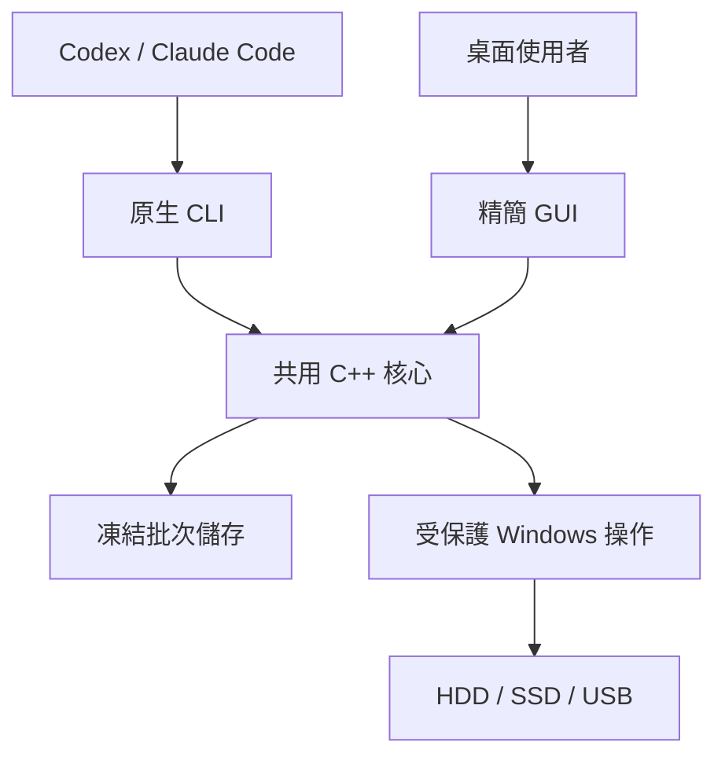

<p align="center"></p>

<h1 align="center">Windows Agent Cleanup</h1>

<p align="center">專為 Agent 設計的 Windows 原生清理工具。一個批次，一份精簡結果。</p>

[](https://github.com/bestkakkoii/windows_agent_cleanup/actions/workflows/ci.yml)
[](https://github.com/bestkakkoii/windows_agent_cleanup/stargazers)
[](LICENSE)

<p align="center"></p>

[English](README.md) · [Agent 入口](README_AI.md) · [發行版本](https://github.com/bestkakkoii/windows_agent_cleanup/releases) · [參與開發](CONTRIBUTING.md) · [安全問題](SECURITY.md)

Windows Agent Cleanup 透過機器專用 CLI 與精簡桌面 GUI 共用的 C++ 原生核心，處理大量專案清理目標。快速模式移除選定名稱，不讀取或覆寫檔案內容；獨立的覆寫流程則提供明確、依證據判定的抹除結果。

**[下載 Windows x64 最新正式發行](https://github.com/bestkakkoii/windows_agent_cleanup/releases/latest)。** Runtime ZIP 包含 GUI／CLI、執行文件、完整 Skill、schema 與授權聲明；原始碼、建置及測試檔案留在 Git。發行版本、實際程式版本、雜湊與驗收範圍，以該 Release 及其 manifest 為準；發行與程式版本可能不同。當前證據及待補驗收項目統一維護於[發布政策](docs/publication.md)，不在 README 複製歷史快照。本專案不宣稱跨硬體最大速度或 NAND 實體抹除保證。

<a id="start-with-your-agent"></a>

## 交給 Agent 使用

一般 Agent 安裝請使用官方 **[Latest Release](https://github.com/bestkakkoii/windows_agent_cleanup/releases/latest)** 的 runtime 資產：

1. 下載同一發行紀錄中的 Windows x64 runtime ZIP 與對應 `.sha256`。GitHub 自動產生的 **Source code (zip/tar.gz)** 是工程原始碼，不是安裝包。
2. **解壓縮前**使用 `Get-FileHash -LiteralPath <下載的ZIP> -Algorithm SHA256`，比對該發行紀錄的校驗碼；缺少校驗碼或不符時停止，不解壓也不執行。
3. 依可用空間、權限及使用者／專案範圍選擇可攜目錄，沒有指定磁碟或父目錄。沿用有效安裝；替換前檢查來源與本機修改，或改用獨立目錄，避免修改開發 checkout。
4. 解壓**完整** runtime 套件，將實際絕對入口路徑交給本機 Agent：

```text
Read <工具實際解壓目錄的絕對路徑>/README_AI.md
```

Agent 沿用既有範圍、計畫與授權，只詢問缺少的選項。一般安裝不下載 `main`／`master` 或自行編譯，也不授權刪除。直接讀取不需要 MCP、編譯器、SDK、Python、Node.js、全域 PATH 或 Skill 註冊。[共用 Skill](skills/project-cleanup/SKILL.md) 是唯一操作流程，只有需要時才讀取延伸參考。原始碼開發是獨立且需明確要求的[工程路線](CONTRIBUTING.md#build-from-source)。

## 使用 GUI

開啟 `bin/secure_erase_gui.exe`，選擇 **Quick delete** 或 **Overwrite and verify**，加入或拖放檔案／目錄。**Start** 準備整個批次；在 **Confirm batch** 檢查並授權不可逆操作。「Frozen targets」指已固定的目標集合，是正常確認流程。完成的輸入會移出清單，未完成者保留供檢查。失敗時複製含原生錯誤碼的診斷 JSON；覆寫降級與強制結束程序需要獨立授權。

## 原生核心實際執行的工作

- CLI／GUI 共用準備、身分檢查、排程、延後失敗恢復及回報流程。
- 變更前凍結目標集合，不處理後來新增或替換的目標。
- 保留系統保護及 reparse 邊界；選定的不同 hard link 名稱分別處理。
- 快速模式採邏輯刪除，不覆寫內容、不完整讀回、不經資源回收筒，也不逐檔發出 TRIM。
- 依即時資源預算及受保護的索引暫存接納大型批次，再由實測完成速率與延遲調整並行度。沒有固定筆數上限；資源不足可拒絕整批工作。
- 詳細失敗留在外部報告，標準輸出回傳精簡的機器可讀摘要。

原始碼支援明確選用的 v2 CLI 契約，提供具型別的主機就緒資訊、共用操作統計與唯讀請求狀態查詢；預設呼叫保留 v1。依確切 runtime 套件宣告的能力選用契約，較新的原始碼文件不會讓舊 EXE 自動具備新功能。

容量觀察值不代表本工作立即釋出了指定容量。其他開啟中的 handle、剩餘 hard link、共用配置與快照，都可能保留資料或空間。



## 建置與檢視

正式目標為 Windows 11 或更新系統、x64、MSVC、C++ 原生命名模組與供應商 `import std`。以 `build_release.bat` 建置 Release，使用靜態 MSVC runtime。建置輸入、命令及驗證邊界見 [CONTRIBUTING.md](CONTRIBUTING.md)。

| 文件 | 用途 |
|---|---|
| [README_AI.md](README_AI.md) | 通用入口與任務分流 |
| [專案清理 Skill](skills/project-cleanup/SKILL.md) | 清理流程、計畫及按需參考 |
| [架構設計](docs/design.md) | 核心邊界與操作不變條件 |
| [快速刪除技術報告](docs/quick_delete_technical_report.md) | 實際 Windows API、演算法、資源公式與重現程序 |
| [已核准需求](spec/requirements.json) | 原始需求與明確修訂 |
| [Windows 測試計畫](docs/windows_test_plan.md) | 平台與儲存裝置證據 |

發行紀錄將每個產物綁定來源參照、二進位來源及實際驗證範圍。雜湊與內嵌身分本身不等於獨立的原始碼到二進位認證；`main` 的文件更新也不會替換已發布資產。[發布政策](docs/publication.md) 區分開發產物、已核准預發行及正式 Release。產生的二進位與逐次日誌不放進原始碼樹。

## 協助與貢獻

可重現問題請至 [Issues](https://github.com/bestkakkoii/windows_agent_cleanup/issues) 回報，提供發行／程式版本、產物雜湊或實測來源 commit、Windows 組建及遮罩後診斷。安全漏洞依 [SECURITY.md](SECURITY.md) 回報；延伸工具請先閱讀 [CONTRIBUTING.md](CONTRIBUTING.md)。專案由 bestkakkoii 與貢獻者維護，採 [MIT](LICENSE) 授權。
